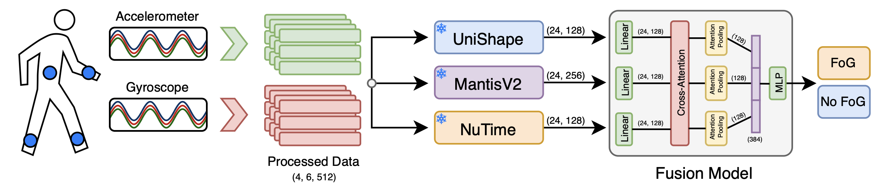
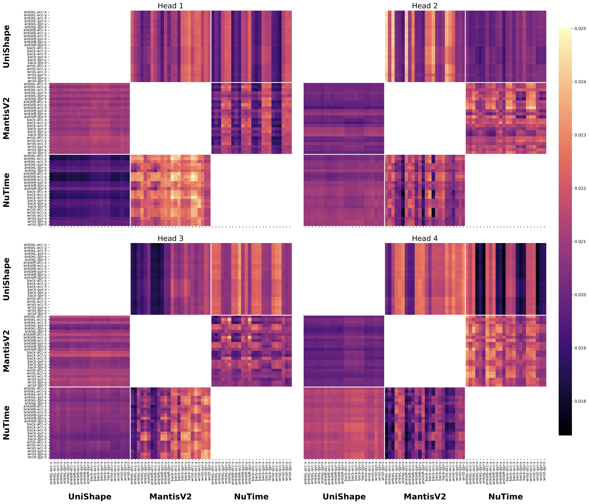

# Freezing-of-gait detection with frozen time-series foundation models

Code and results for detecting freezing of gait (FoG) in people with Parkinson's
disease from wearable inertial sensors. Features are extracted by pretrained
time-series foundation models (UniShape, MantisV2, NuTime) whose weights stay
frozen. A small cross-attention classifier is then trained on those features.



Each window is passed through the frozen encoders one channel at a time. The fusion
model ([`src/model/ensemble.py`](src/model/ensemble.py)) projects each model's
channel tokens to a shared size and lets every model attend to the other models'
tokens. It then pools each model's tokens and classifies their concatenation.

The study covers 315 runs: 7 foundation-model subsets across 45 sensor
configurations (15 combinations of 4 body placements × 3 modalities). Models are
evaluated with a subject-independent split.

> **Paper:** coming soon. A link to the accompanying paper and its citation will be
> added here once it is available.

## Repository layout

| Path | Contents |
|---|---|
| `preprocessing/` | Standalone CSV-to-windows processor (see its [README](preprocessing/README.md)) |
| `save_features.py` | Extracts foundation-model features into an LMDB |
| `train_subset.py` | Trains and evaluates one sensor configuration and model subset |
| `run_grid.sh` | Runs all 315 grid cells, skipping finished ones |
| `split_11_5_6.csv` | Participant-level train/val/test split (11/5/6 participants) |
| `src/` | Data, model (`src/model/ensemble.py`), loss, metric and training code |
| `tools/grid/` | Builds the results table, bootstrap confidence intervals and attention plots |
| `experiments/Combination_Ablation/Comb_Ensembles/` | Metrics, results and per-window predictions for each of the 315 runs |
| `results/grid_7x45.csv` | The full grid, built from those predictions |
| `assets/` | Figures used in this README |

## Cross-attention



Cross-attention weights of the four heads of the U+M+N model on all four IMUs
(`p0123_s2`), averaged over the test participants. Each model (rows) attends only
to the channel tokens of the other two (columns), so the same-model blocks are
empty. The heads learn visibly different patterns.

The figure was made with:

```bash
uv run tools/grid/plot_cross_attention.py --combo p0123_s2 --fm UMN --split test --out cross_attention_umn.pdf
```

## Setup

Requires [uv](https://docs.astral.sh/uv/), which sets up Python 3.12 from `.python-version`.

```bash
uv sync
```

### Data

The experiments use the FoG-STAR dataset, which is not included here:

> L. Borzì et al., "A multi-level annotated sensor dataset of gait freezing
> manifestations and severity in Parkinson's disease," *Scientific Data*, vol. 13,
> no. 1, p. 305, 2026.

Place the CSV at `datasets/sensor_data.csv`.

### Pretrained weights

Weights are not included.

| Model | Source | Location |
|---|---|---|
| UniShape | [Liu et al., arXiv:2601.06429](https://arxiv.org/abs/2601.06429) | `weights/unishape_checkpoint_zeroshot.pth` |
| NuTime | [Authors' repository](https://github.com/chenguolin/NuTime/blob/main/ckpt/checkpoint_bias9.pth) (Lin et al., *TMLR* 2024) | `weights/checkpoint_bias9.pth` |
| MantisV2 | [Feofanov et al., arXiv:2602.17868](https://arxiv.org/abs/2602.17868) | Downloaded automatically from Hugging Face (`paris-noah/MantisV2`) |

## Reproducing the results

Run these from the repository root.

```bash
uv run preprocessing/process_sensor_csv.py
```

```bash
uv run save_features.py
```

```bash
./run_grid.sh
```

```bash
uv run tools/grid/collect_grid.py
```

```bash
uv run tools/grid/bootstrap_ci.py
```

To train a single cell, for example UniShape + MantisV2 on all placements and
modalities:

```bash
uv run train_subset.py --combo p0123_s2 --ensemble UM
```

Combination keys read `p<placements>_s<modality>`:

- **Placements:** `0` left ankle, `1` right ankle, `2` back, `3` wrist
- **Modalities:** `s0` gyroscope, `s1` accelerometer, `s2` both (defined in
  [`sensor_labels.py`](src/data/sensor_labels.py))

### Notes on reproducibility

- Training does not set a random seed, so retrained numbers will differ slightly.
- Thresholded metrics in `results/grid_7x45.csv` use the equal-error-rate threshold
  chosen on validation, so the test set is not used to choose it.
- Checkpoints are not included. `tools/grid/plot_cross_attention.py` needs a
  checkpoint and the config written by training, so it only works after retraining.

## Third-party code and models

`src/model/uni_shape/` and `src/model/nutime.py` implement the UniShape and NuTime
encoders so that their published weights can be loaded. MantisV2 is installed from
the `mantis-tsfm` package.

## License

This project's own code is released under the [MIT License](LICENSE). Third-party
code, models and weights remain under their own licenses.
